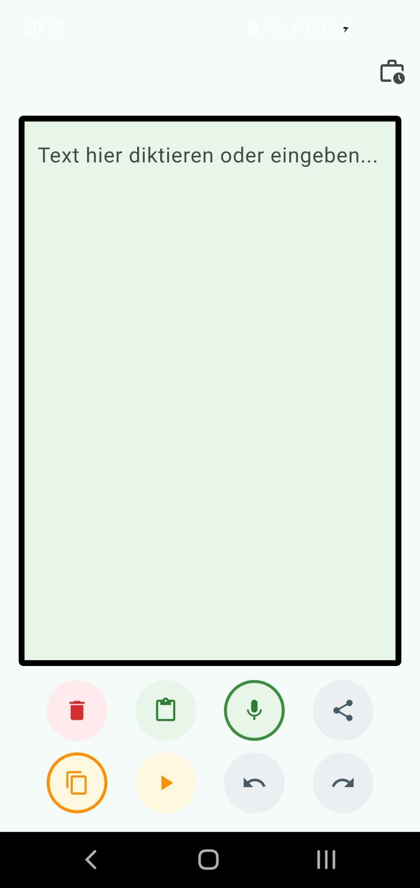
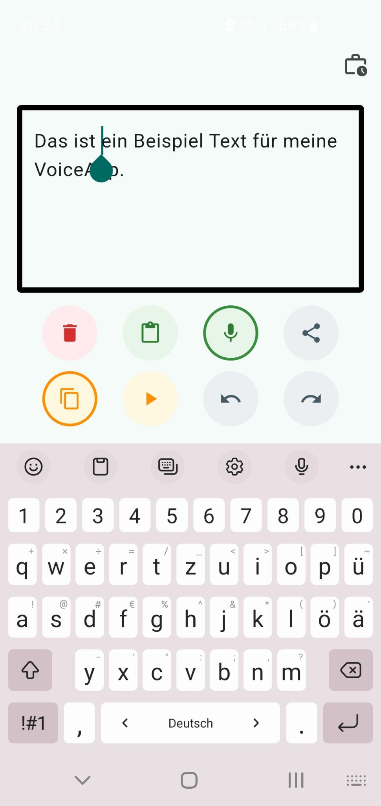
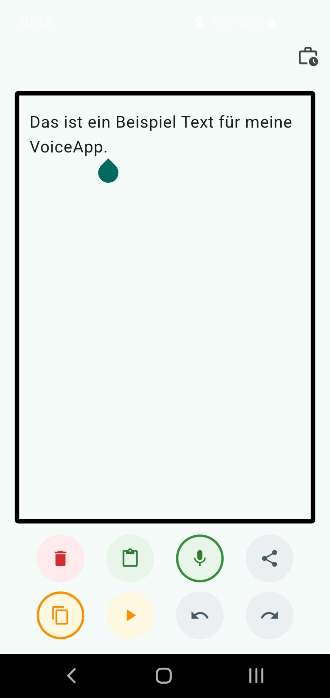

# VoiceApp – Diktieren, Vorlesen & Audio-Transkription

Eine schlanke, werbefreie Android-App zum Diktieren und Vorlesen von Text
und zum Umwandeln von Audiodateien in Text. Kein Konto, kein Tracking,
keine Werbung. Die App selbst überträgt keine Texte an Server.

## Screenshots






## Funktionen

- Text per Spracheingabe diktieren, auch mitten im Text an der
  Cursor-Position oder anstelle einer Markierung
- Gesprochene Satzzeichen ("Komma", "Punkt", "Fragezeichen" ...) werden
  als echte Zeichen eingefügt
- Automatische Großschreibung nach Satzzeichen
- Text vorlesen lassen, ab der Cursor-Position, mit Pause/Stopp
- Audiodatei auswählen und in Text umwandeln (Whisper, läuft nach einem
  einmaligen Modell-Download offline auf dem Gerät)
- Rechtschreibvorschläge beim Tippen (Android-Rechtschreibprüfung)
- Text bearbeiten, kopieren, einfügen, teilen, Rückgängig/Wiederholen
- Text bleibt beim Schließen der App erhalten (lokal gespeichert)
- Text in anderen Apps markieren und im Auswahlmenü **"Vorlesen"** wählen

### Hinweise

- **Auswahlmenü "Vorlesen":** Das funktioniert nicht in allen Apps. Ob der
  Eintrag erscheint, entscheidet die jeweilige App bzw. der
  Geräte-Hersteller. Der markierte Text ersetzt dabei den aktuellen Inhalt
  des Textfelds in VoiceApp.
- **Audio-Transkription:** Beim ersten Mal lädt die App einmalig das
  Sprachmodell herunter (ca. 140 MB, WLAN empfohlen). Danach braucht die
  Umwandlung kein Internet. Lange Aufnahmen können je nach Gerät einige
  Minuten dauern.
- **Spracherkennung beim Diktieren:** Sie nutzt die Funktion deines
  Android-Geräts. Ob diese lokal oder über einen Online-Dienst arbeitet,
  hängt von den Spracheinstellungen deines Geräts ab, nicht von dieser App.

## Datenschutz

Die App speichert Texte ausschließlich lokal auf dem Gerät. Es gibt keine
Werbung, keine Analyse-Tools und keine Datenweitergabe an Dritte.
Details siehe [PRIVACY.md](./PRIVACY.md).

## Technik

Gebaut mit [Flutter](https://flutter.dev). Verwendete Pakete:

- [`speech_to_text`](https://pub.dev/packages/speech_to_text) – Diktierfunktion
- [`flutter_tts`](https://pub.dev/packages/flutter_tts) – Vorlesefunktion
- [`whisper_ggml`](https://pub.dev/packages/whisper_ggml) – Audio-Transkription (Whisper)
- [`file_picker`](https://pub.dev/packages/file_picker) – Auswahl der Audiodatei
- [`share_plus`](https://pub.dev/packages/share_plus) – Teilen-Funktion
- [`shared_preferences`](https://pub.dev/packages/shared_preferences) – lokales Speichern des Texts

Diktieren und Vorlesen laufen über die auf dem jeweiligen Android-Gerät
installierten System-Engines (nicht Teil dieser App).

## Berechtigungen

| Berechtigung | Wofür |
|---|---|
| Mikrofon | Diktierfunktion |
| Internet | einmaliger Download des Sprachmodells für die Audio-Transkription; technische Voraussetzung des Spracherkennungs-Pakets |

## Selbst bauen

Voraussetzung: [Flutter SDK](https://flutter.dev/docs/get-started/install)
installiert.

```bash
git clone https://github.com/falkojana/voiceapp.git
cd voiceapp
flutter pub get
flutter run
```

Release-APK bauen:

```bash
flutter build apk --release
```

Die fertige Datei liegt danach unter
`build/app/outputs/flutter-apk/app-release.apk`.

## Mitmachen

Fehler gefunden oder eine Idee für eine Verbesserung? Gerne ein
[Issue](https://github.com/falkojana/voiceapp/issues) eröffnen oder einen
Pull Request einreichen.

## Lizenz

[MIT](./LICENSE) – frei nutzbar, veränderbar und weiterverteilbar.

## Kontakt

Bei Fragen: fotosort.app@gmail.com
